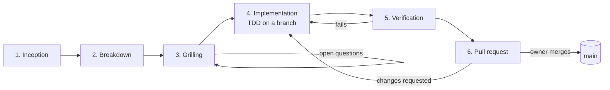

# AI-assisted delivery workflow

Every piece of work moves through six stages. Each stage produces a written artifact, so any session (human or AI) can pick up where the last one stopped.

| Stage | Skill | Input | Output | Exit criteria |
| --- | --- | --- | --- | --- |
| 1. Inception | `inception` | An idea or roadmap phase | `docs/specs/<feature>/inception.md` | Problem, users, success criteria and out-of-scope agreed with the owner |
| 2. Breakdown | `breakdown` | Inception doc | `docs/specs/<feature>/breakdown.md` + one `slice-NN-<name>.md` per slice | Each slice is vertical, independently mergeable, about a day of work, with acceptance criteria and a test plan |
| 3. Grilling | `grill` | One slice spec | "Grilling log" and "Decisions" sections in the slice spec | No open questions left; owner has answered or explicitly deferred each one |
| 4. Implementation | `implement` | Grilled slice spec | Commits on `slice/...` branch | Every acceptance criterion has a passing test |
| 5. Verification | `verify` | The branch | Verification checklist in the PR | Full test suites, linters and build pass; diff self-reviewed |
| 6. Pull request | `verify` (last step) | Verified branch | PR with base `main` | Owner reviews and merges. AI never merges |

## 1. Inception

Goal: agree on **what** and **why** before anyone thinks about **how**.

- Restate the problem in one paragraph, from the loan officer's point of view.
- Name the users (persona) and the questions or jobs this feature serves.
- Define measurable success criteria (for example, "answers balance questions with the exact API figure in 100% of golden-set cases").
- List constraints (security, data, cost, latency) and what is explicitly **out of scope**.
- List open questions for the owner.

Template: `docs/specs/_templates/inception.md`.

## 2. Breakdown

Goal: turn the feature into **vertical slices** that each deliver something testable end to end.

Rules for a good slice:

- **Vertical:** touches every layer it needs (data, API, tool, agent, UI) rather than one layer for the whole feature.
- **Independently mergeable:** `main` stays working after each slice.
- **Small:** about one day of work, one PR.
- **Testable:** has acceptance criteria written as observable behaviour (Given / When / Then).
- **Ordered:** dependencies between slices are explicit.

Output: `breakdown.md` (the ordered list) and one `slice-NN-<name>.md` per slice from `docs/specs/_templates/slice.md`.

## 3. Grilling session

Goal: find the holes in a slice **before** code exists, when changing the plan is cheap.

The AI acts as a demanding senior reviewer and questions the owner **one question at a time**, waiting for each answer. It covers, at minimum:

- **Behaviour:** what exactly happens on the happy path? Which inputs are valid?
- **Edge cases:** empty data, boundaries (a payment on the due date, a leap year, zero balance), duplicates, concurrency.
- **Failure modes:** downstream service down, timeouts, bad data, LLM refuses or hallucinates.
- **Domain correctness:** which policy or agreement clause defines the rule? Rounding? Currency?
- **Security and access:** who may see or do this? What is logged in the audit trail?
- **Testing:** how will each acceptance criterion be proven? What is the test data?
- **Scope:** what is deliberately left for a later slice?

Every question and answer goes into the slice's **Grilling log**. Resulting choices go into **Decisions**, and acceptance criteria are updated. Questions the owner defers are listed as **Deferred** with a reason.

The slice is ready for implementation only when the grilling log has no unanswered question.

## 4. Implementation

1. `git fetch origin && git switch -c slice/<phase>-<name> origin/main`
2. For each acceptance criterion: write a failing test, make it pass, refactor (red → green → refactor).
3. Commit in small steps with messages that explain why.
4. Keep the slice spec up to date if reality differs from the plan, and note it in the PR.
5. Never commit to `main` (see `CLAUDE.md`).

## 5. Verification

Before opening the PR, run and record:

- [ ] Full test suite for every touched area (see `CLAUDE.md`, Commands)
- [ ] Build and lint pass
- [ ] Every acceptance criterion is ticked and linked to its test
- [ ] Self-review of the full diff: no debug code, no secrets, no unrelated changes
- [ ] Docs and the slice spec updated

## 6. Pull request

- Push the branch and open a PR with **base `main`**, using `.github/pull_request_template.md`.
- Title: `[P<phase>] <slice name>` (for example `[P1] Loan position tests`).
- Link the slice spec, paste the verification checklist and note anything deferred.
- The owner reviews. The AI addresses comments with new commits on the same branch and never merges.
